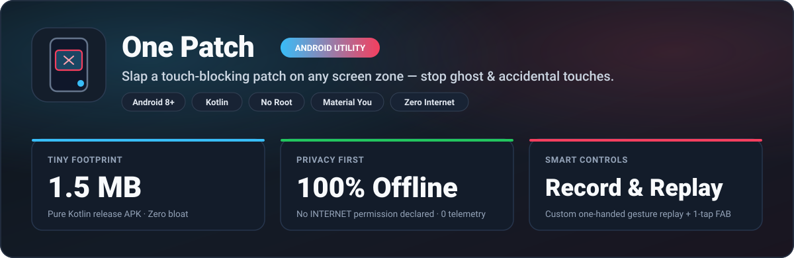
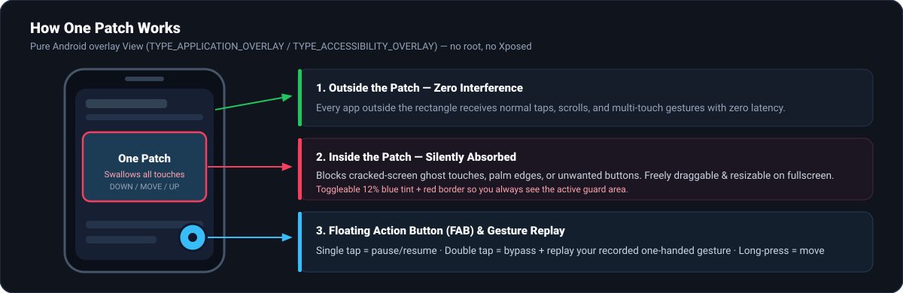

<p align="center">
  
</p>

<p align="center">
  <a href="https://github.com/Overbaker/One-Patch/releases/latest"></a>
  <a href="LICENSE"></a>
  
  
  
</p>

<p align="center">
  <a href="https://github.com/Overbaker/One-Patch/releases/latest"><strong>Download APK</strong></a> ·
  <a href="#quick-setup"><strong>Setup</strong></a> ·
  <a href="#fab--gesture-replay"><strong>Controls</strong></a> ·
  <a href="PRIVACY.md"><strong>Privacy</strong></a> ·
  <a href="https://github.com/Overbaker/One-Patch/discussions"><strong>Discussions</strong></a>
</p>

---

**One Patch** is a lightweight (**~1.5 MB**), **100% offline** Android utility (Kotlin, no root, zero internet permission) that places a draggable, resizable touch-blocking rectangle over any screen zone — ideal for cracked-screen ghost touches, palm contact, or accidental edge taps — with a one-tap floating toggle and **recordable one-handed-mode gesture replay**.

## How It Works

<p align="center">
  
</p>

## Quick Setup

Download the latest APK from [**Releases**](https://github.com/Overbaker/One-Patch/releases/latest) (or `adb install -r app-release.apk`):

| Step | Action |
|---|---|
| **1** | Grant **"Display over other apps"** permission |
| **2** *(recommended)* | Enable **One Patch Accessibility Service** (*Settings → Accessibility → Installed services*) for trusted `TYPE_ACCESSIBILITY_OVERLAY` |
| **3** *(Xiaomi / HyperOS)* | Allow **"Show on lock screen"** + **"Display pop-up windows while running in background"** and set **Battery saver → No restrictions** |
| **4** *(optional)* | Tap **录制单手模式手势** to record your device's exact OEM one-handed trigger gesture once |

## FAB & Gesture Replay

| Action | Behavior |
|---|---|
| **Single tap** | Toggle patch bypass (pause / resume touch blocking) |
| **Double tap** | Force bypass on + replay your recorded one-handed gesture |
| **Long-press drag** | Move the FAB anywhere on screen |
| **Quick Toggle alias** | Bind to Xiaomi 敲击背部 / 悬浮球 / launcher shortcut |
| **TalkBack action** | Accessible custom action equivalent to double-tap |

> **Why recordable gestures?** HyperOS (bottom-edge swipe), OneUI (corner swipe), and ColorOS (three-finger pinch) all trigger one-handed mode differently. Record once (3-2-1 countdown, up to 60 s) — coordinates rescale automatically across display density/resolution changes.

## Key Highlights

- **Zero Telemetry / Fully Offline**: No `INTERNET` permission declared ([PRIVACY.md](PRIVACY.md)).
- **Material You & HyperOS Survival**: Dynamic colors (Android 12+), foreground service, auto-bypass when the display shifts.
- **No Root / No Xposed**: Pure `TYPE_APPLICATION_OVERLAY` / `TYPE_ACCESSIBILITY_OVERLAY`.

<details>
<summary><strong>Known Android platform boundaries & HyperOS notes</strong></summary>

- **Cannot block**: status bar, system gesture bars, IME keyboard, or apps calling `HIDE_OVERLAY_WINDOWS` (banking/payment/password fields).
- **Android 13+**: users can stop the foreground service from Task Manager.
- **HyperOS one-handed mode ([#1](https://github.com/Overbaker/One-Patch/issues/1))**: Xiaomi HyperOS applies a SurfaceFlinger display-area transform that shifts even `TYPE_ACCESSIBILITY_OVERLAY` and Android 14 `attachAccessibilityOverlayToDisplay` surfaces. **Workaround (default)**: keep `屏蔽区物理坐标锁定` off so the patch auto-bypasses during one-handed mode and resumes on fullscreen.

</details>

<details>
<summary><strong>Build from source (JDK 17 · Android SDK 34)</strong></summary>

```bash
git clone https://github.com/Overbaker/One-Patch.git && cd One-Patch
./scripts/gen-keystore.sh
cp keystore.properties.template keystore.properties   # fill in passwords
./gradlew :app:assembleRelease
# → app/build/outputs/apk/release/app-release.apk
```

</details>

<details>
<summary><strong>FAQ</strong></summary>

- **Does One Patch work for ghost touches on a cracked screen?** Yes — resize and drag the patch directly over the broken digitizer region to absorb spurious taps while keeping the rest of the screen usable.
- **Does it require root or internet access?** Neither. It uses standard Android overlay/accessibility APIs and declares zero internet permissions.

</details>

---

Licensed under **MIT** ([LICENSE](LICENSE)). See [CONTRIBUTING.md](CONTRIBUTING.md) for contributions and device reports.
